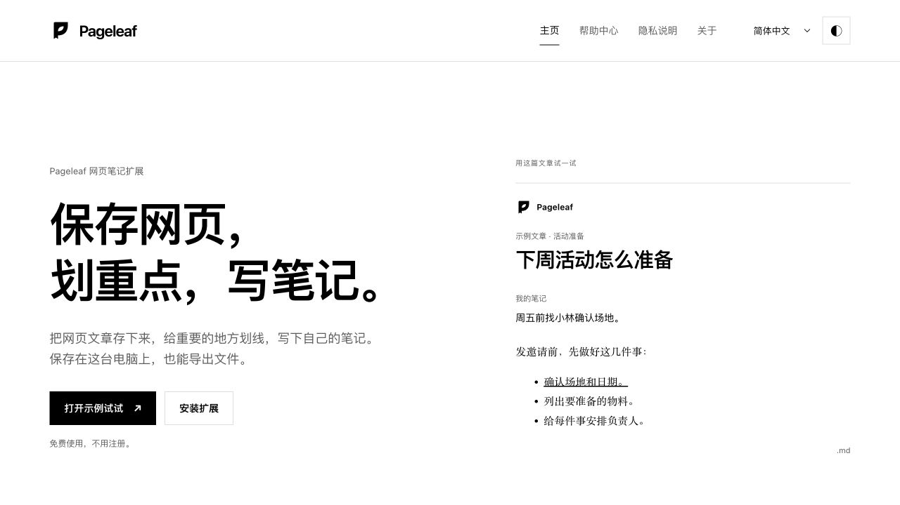
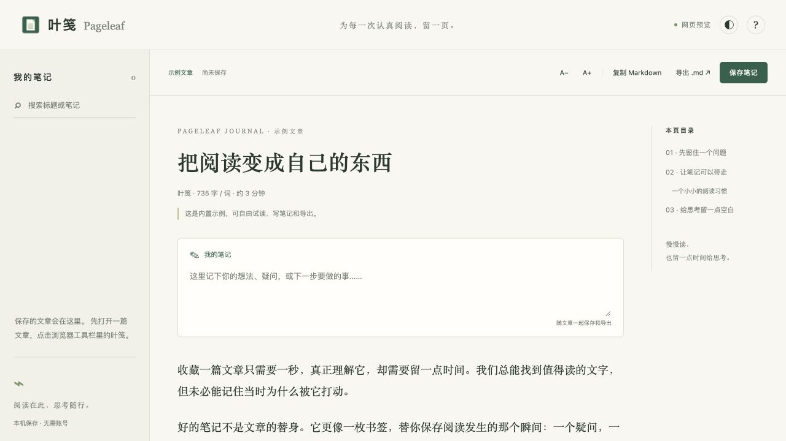

# Pageleaf

Read an article. Add your thoughts. Keep a portable copy.

Pageleaf is a local-first Chrome extension that turns web articles or selected text into readable notes. **v0.3.1** provides Home, searchable Help, Privacy and About pages, a black-and-white identity, and seven interface languages. Excerpt previews now appear directly at the end of the article, without a popup or decorative box. No account, API key or subscription is required.

[中文使用说明](README.md#中文使用说明) · [Website and demo](https://2022x126.github.io/pageleaf/) · [Privacy](PRIVACY.md) · [Contributing](CONTRIBUTING.md) · [Download development releases](https://github.com/2022x126/pageleaf/releases)



## A complete starting point

Home explains the product, offers a reader demo and leads to installation instructions. The Help center covers capture, saving, search, export, backups, shortcuts, troubleshooting and data deletion, with a search field for finding a topic. Privacy describes actual local storage and permissions; About includes project status, licenses and contribution links.

All four pages ship inside the extension. A new installation opens Home, and Chrome's extension options also opens Home. The reader links back to Home, Help and Privacy. These pages do not require an external service; links to GitHub are external and open only when selected.

## Languages and reading

The interface and product guides are available in:

| Language | UI locale |
| --- | --- |
| English | `en` |
| 简体中文 | `zh-CN` |
| Español | `es` |
| Français | `fr` |
| Deutsch | `de` |
| 日本語 | `ja` |
| العربية | `ar` |

Automatic selection follows browser language preferences, with English as the fallback. The language selector lets you choose a language explicitly after the initial automatic selection. Arabic uses a right-to-left interface; dates and numeric labels use locale-aware formatting. **Changing the interface language does not translate articles or personal notes.** Translation corrections and accessibility feedback are welcome; this does not claim native-speaker review or support for every language or website.

The shared product name is Pageleaf, with 叶笺 used in the Chinese interface. The [Leaf-P logo](docs/BRAND.md) uses a bookmark spine and a leaf-shaped space, without language-specific lettering. The product keeps the minimal white/black design: no decorative backgrounds, gradients, textures or remote fonts.

## Useful features

- Capture an article on demand; selected text takes priority.
- Read with a table of contents, adjustable type, white/black appearance and personal notes.
- Select text to highlight it, underline it, or add a wavy underline. Draw with the pen; undo or clear your marks. Save to keep them.
- Collect marked quotes, or the first sentence of each section, into a preview. Add the result to your note without replacing your writing. This uses original sentences, not an AI summary.
- Search saved titles, source URLs, personal notes, article text and Markdown.
- Explicitly save notes in the current Chrome profile; reopen saved notes at their last reading position. Deletion requires confirmation.
- Copy or download Markdown with the source, article, your personal note and marked quotations. Pen strokes stay in the saved note and JSON backup; they are not converted to Markdown.
- Export a whole-library JSON backup; preview a restore, re-sanitize content, skip duplicates and preserve existing notes.
- Open the browser's print dialog to choose a printer or Save as PDF.



## Install a development build

Pageleaf is a development release and is **not published in the Chrome Web Store**. Download the installation ZIP from [Releases](https://github.com/2022x126/pageleaf/releases) and extract it. In desktop Chrome 116+, open `chrome://extensions`, enable Developer mode, select **Load unpacked**, and choose the extracted directory containing `manifest.json`. Pin Pageleaf, open an ordinary HTTP/HTTPS article and click its toolbar icon, or use `Alt/⌥ + Shift + L`.

To build from source, use Node.js 22+:

```sh
npm ci
npm run check
```

Load the generated **`dist` directory**, not the source root or ZIP file. You can reopen Home from the extension's options. Capture still starts from the toolbar or shortcut on the article you want to read.

## Backup and local data

The library is limited to **100 notes**, each saved or restored note to **1 MB**, and a JSON backup to **20 MB**. Restoration validates format, sizes and the resulting library count before writing. Existing IDs and matching source/extraction-mode/article-text combinations are skipped; existing notes are not overwritten. Backups contain notes only, excluding reading positions and language/display preferences. If the library exceeds the backup file limit, export individual Markdown files before reducing it.

Unsaved captures stay in browser session memory, with at most six records. Captures older than 24 hours are pruned when a new capture is made; browser exit clears session captures. Explicitly saved notes, reading positions and preferences stay in the current Chrome profile without additional encryption. Deleting a note also deletes its reading position, but not exported files or printed copies. Back up before uninstalling or changing profiles.

Permissions remain `activeTab`, `scripting` and `storage`. There is no persistent host access, telemetry or cloud sync. Original article images and embeds are removed. Source and article links have credentials, query strings and fragments stripped; some links may need manual correction. Opening an external link is a browser navigation to that site's service. See [PRIVACY.md](PRIVACY.md).

## Development and verification

```sh
npm test                         # extraction, safety, storage and interface behavior
npm run build                    # build dist; no node_modules needed at runtime
npm run check                    # tests, build, permissions, resources and CSP checks
npm run package                  # install/source ZIPs in the parent directory
npm run build:site               # standalone static product site in site-dist
node scripts/generate-icons.mjs  # reproduce SVG and correctly sized PNG icons
```

All runtime code and product translations are bundled. Dependency versions are fixed by the lockfile. See [third-party licenses](THIRD_PARTY_NOTICES.md), [maintenance notes](docs/MAINTENANCE.md) and [validation notes](docs/VALIDATION.md).

Automated tests and web previews do not replace installed Chrome checks for toolbar capture, browser-restart persistence or downloaded files. Screenshots in this README show public sample content in a web preview; they do not imply Chrome Web Store publication or installed-extension acceptance.

## Local product preview

After building, run `python3 -m http.server 8765 --bind 127.0.0.1` from the project directory. Open `http://127.0.0.1:8765/dist/index.html` for Home or `http://127.0.0.1:8765/dist/reader.html?demo` for the reader sample. Language and white/black appearance choices may persist in this site's local browser storage; **preview articles and notes stay in page memory and disappear on refresh**. Export anything you want to keep. The preview cannot capture another browser tab.

`npm run build:site` also builds the standalone static product site in `site-dist` without the extension manifest or background worker. Hosting and deployment boundaries are documented in [WEBSITE.md](docs/WEBSITE.md). A hosted product site makes normal requests to its hosting provider for pages and assets; it still does not upload preview articles or notes. A generated site is not proof of a live deployment.

## Limits and open source

Extraction depends on page structure. PDFs, image/video-only content, browser internal pages and some complex applications are unsupported. Pageleaf does not bypass logins, paywalls or access controls, or fetch unloaded pagination/iframe contents. Images are omitted; complex tables and formulas may need manual correction. Desktop Chrome is the current target; mobile browsers and other browser configurations have no blanket compatibility guarantee.

Original code is [MIT licensed](LICENSE). Captured articles remain subject to their authors' rights; keep source attribution when sharing. Report reproducible problems or translation corrections through [GitHub Issues](https://github.com/2022x126/pageleaf/issues), without uploading private articles, notes or backups.

## 中文使用说明

Pageleaf（叶笺）可以保存网页文章、划重点、写笔记。0.3.0 加入主页、帮助中心、隐私说明和关于页面，支持七种界面语言，以及纯白、纯黑外观。切换界面语言不会翻译文章和你的笔记。

从 [Releases](https://github.com/2022x126/pageleaf/releases) 下载安装 ZIP 并解压。在电脑版 Chrome 的 `chrome://extensions` 开启开发者模式，点“加载已解压的扩展程序”，选择包含 `manifest.json` 的文件夹。如果自己构建源码，就选择 `dist`。目前还没上架 Chrome 应用商店。

打开文章，点 Chrome 工具栏里的 Pageleaf；只想保存几段话，就先选中文字。进入阅读页后，可以划重点、加下划线或波浪线，也可以用画笔圈画。点“整理重点”查看摘录，再决定是否标回原文或加入自己的笔记。最后点“保存笔记”。

已保存的文章和笔记都能搜索，下次打开会接着上次读。可以复制或导出 Markdown、打印成 PDF，也可以备份整个笔记库。Markdown 包含划线原句，不包含画笔；JSON 备份保留画笔和文字标记。

笔记库最多 100 篇，单篇不超过 1 MB，备份文件不超过 20 MB。恢复备份时会跳过重复笔记，不覆盖已有内容；备份不含阅读位置和显示偏好。

文章和笔记在本机处理，不会上传。没点保存的内容只是临时保留；在线试用刷新后就会清空，请及时导出。卸载扩展或换电脑前，记得备份。权限只有 `activeTab`、`scripting`、`storage`，用途见[隐私说明](PRIVACY.md#中文说明)；验证情况见[实际验证记录](docs/VALIDATION.md)。
